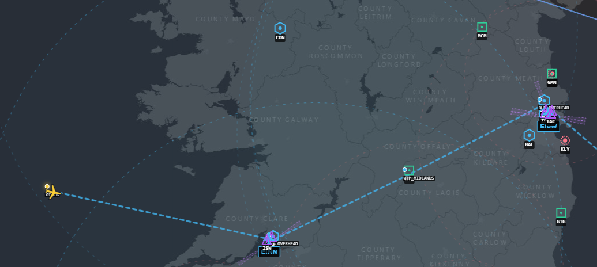
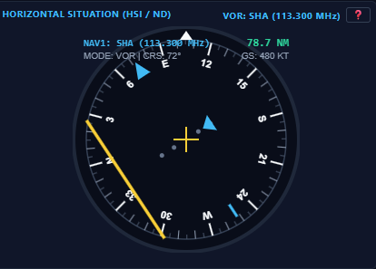
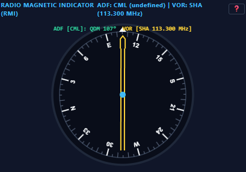
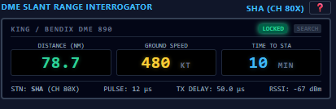
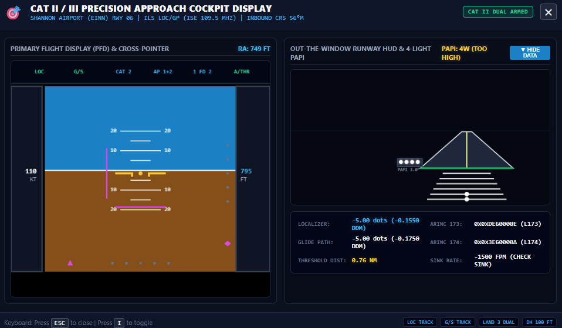
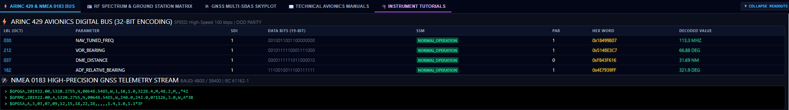

# ✈️ Aeronautical Radio Navigation & Cockpit Avionics Simulator

[](https://www.python.org/)
[](https://www.typescriptlang.org/)
[](https://fastapi.tiangolo.com/)
[](https://www.icao.int/)
[](https://www.aviation-ia.com/)
[](https://opensource.org/licenses/MIT)

A high-fidelity aeronautical radio navigation and digital avionics simulation library built to **ICAO Annex 10** and **ARINC Specification 429** engineering standards.

The library simulates real-time electromagnetic wave propagation, 4/3 Earth radio line-of-sight geometry, slant-range mechanics, receiver electronics, and digital avionics data buses for en-route and terminal airspace operations, validated against the Shannon and Dublin Flight Information Regions (`EISNFIR` & `EISNUIR`) and international airport reference datasets.

It includes a modern **TypeScript Tactical Moving Map & Glass Cockpit Display** showcase app with real-time 10 Hz WebSocket telemetry streaming, interactive tutorials with labeled instrument diagrams, persistent manual radio tuning, collapsible engineering readouts, and a full-screen precision approach cockpit modal.



---

## 🏗️ System Architecture

```text
Navigation_aid_simulator/
├── navaid_sim/                 # Reusable Python Simulation Package (pip install -e .)
│   ├── core/
│   │   ├── geo.py              # Great Circle geodesy, rhumb lines, DMS coordinate parsing, magnetic variation
│   │   ├── physics.py          # 4/3 Earth radio horizon, free-space path loss, DME slant range, VOR cone of confusion, ILS DDM
│   │   └── protocol.py         # 32-bit ARINC 429 word encoder (odd parity, reversed octal labels) & NMEA 0183 ($GPGGA, $GPRMC)
│   ├── database/
│   │   └── loader.py           # Ingestion of FIR.csv, Navaids.txt, IE_Waypoints.txt, EINN.txt, EIDW.txt, EICK.txt
│   ├── models/
│   │   ├── aircraft.py         # Aircraft state, 6-DOF kinematics, rate-limited turns, autopilot guidance
│   │   ├── navaid.py           # VOR, DME, NDB, ILS (LOC/GP), GNSS constellation simulation models
│   │   └── avionics.py         # Airborne receiver suite (NAV1, NAV2, DME1, ADF1, GNSS, ARINC bus, telemetry log)
│   ├── scenarios/
│   │   ├── definitions.py      # 3 detailed flight scenarios using official IE_Waypoints
│   │   └── runner.py           # Real-time trajectory execution, waypoint passage detection, scrubber
│   ├── data/                   # Bundled airspace datasets (FIR, Navaids, Waypoints, Airports)
│   ├── server.py               # FastAPI REST endpoints + 10 Hz WebSocket telemetry stream
│   └── cli.py                  # CLI inspection, facilities scanner, and headless simulation runner
├── ui/                         # Modern TypeScript Glass Cockpit & Tactical Map UI (Vite)
│   ├── src/
│   │   ├── instruments/
│   │   │   ├── hsi_display.ts  # Electronic Horizontal Situation Indicator (HSI / ND in Rose mode)
│   │   │   ├── rmi_display.ts  # Dual-needle Radio Magnetic Indicator (Pointer 1 ADF, Pointer 2 VOR)
│   │   │   ├── dme_display.ts  # Digital LED Slant Range, Groundspeed & TTS Interrogator
│   │   │   ├── ils_profile.ts  # ILS Vertical Descent Profile (3.0° GP) & Cross-Pointer Flight Director
│   │   │   └── gnss_display.ts # Polar satellite skyplot, elevation rings, and RAIM protection levels
│   │   ├── map/
│   │   │   └── airspace_map.ts # Tactical map (OpenStreetMap / Esri Canvas - NO API Key required)
│   │   ├── views/
│   │   │   ├── scenario_ctrl.ts# 3 Scenario cards, timeline scrubber, play/pause, speed controls (1x to 50x)
│   │   │   ├── avionics_bus.ts # Real-time ARINC 429 digital bus stream (32-bit binary & hex) + NMEA terminal
│   │   │   └── receiver_matrix.ts # Live frequency scanner across all 37 Irish ground navigation facilities
│   │   ├── api.ts              # WebSocket client + REST integration
│   │   └── main.ts             # Application coordinator
│   └── dist/                   # Built production bundle (served automatically by FastAPI)
├── examples/                   # Standalone Python scripts demonstrating library usage
│   ├── simulate_vor_flight.py  # VOR/DME tracking and ARINC 429 bus streaming
│   └── simulate_ils_approach.py# ILS precision approach down to Shannon Runway 24
├── tests/
│   └── test_simulation.py      # Automated unit test suite (geodesy, physics, protocols, scenarios)
├── pyproject.toml              # Modern Python packaging configuration (PEP 517/518, PEP 621)
├── setup.py                    # Legacy setuptools fallback
└── run_sim.py                  # Top-level launcher (starts server & opens browser)
```

---

## 📐 Standards Conformance Matrix

| System / Protocol | Reference Standard | Implemented Technical Specifications |
| :--- | :--- | :--- |
| **VOR / DVOR** | **ICAO Annex 10 Vol I, §3.3** | VHF 108.000–117.975 MHz; 30 Hz AM/FM phase comparison; $\pm 10^\circ$ full scale deflection ($2.0^\circ/\text{dot}$ on 5-dot CDI); TO/FROM flag ambiguity resolution; overhead **Cone of Confusion** ($\sim 40^\circ$ half-angle null zone); terrain sector masking. |
| **DME** | **ICAO Annex 10 Vol I, §3.5**<br>**ARINC 709** | UHF 960–1215 MHz; paired frequency channels; $12\,\mu\text{s}$ (X-channel) / $36\,\mu\text{s}$ (Y-channel) pulse spacing; calibrated $50.0\,\mu\text{s}$ ground transponder delay; 3D **Slant Range** calculation; velocity readout; SEARCH and TRACK/LOCKED state machine. |
| **NDB / ADF** | **ICAO Annex 10 Vol I, §3.4**<br>**ARINC 702** | LF/MF 190–1750 kHz; vertically polarized groundwave propagation; crossed ferrite loop null pattern combined with omnidirectional sense antenna (cardioid pattern $R(\theta) = 1 + \cos\theta$); Relative Bearing (RB), QDM, and QDR; 1020 Hz Morse ID audio keying; night effect. |
| **ILS** | **ICAO Annex 10 Vol I, §3.1**<br>**ARINC 710** | **Localizer**: VHF 108.10–111.95 MHz, dual-frequency 90/150 Hz amplitude modulation, Difference in Depth of Modulation ($0.155\text{ DDM} = \pm 2.5^\circ$ FSD, $0.5^\circ/\text{dot}$).<br>**Glide Path**: UHF 329.15–335.00 MHz, nominal $3.0^\circ$ descent slope, $0.175\text{ DDM} = \pm 0.7^\circ$ FSD ($0.14^\circ/\text{dot}$). Autoland CAT I/II/III arming. |
| **GNSS / SBAS** | **RTCA DO-229D**<br>**ICAO Annex 10 Vol I, §3.7** | L1 C/A 1575.42 MHz; multi-constellation satellites (GPS + Galileo); Dilution of Precision matrix ($Q = (G^T G)^{-1}$; HDOP, VDOP, PDOP); Receiver Autonomous Integrity Monitoring (RAIM) Horizontal Protection Level (HPL) vs Alert Limits (HAL). |
| **ARINC 429** | **ARINC Specification 429-19** | 32-bit bipolar return-to-zero digital words; bit-reversed octal label; Source/Destination Identifier (SDI); 19-bit data field (BNR two's complement and BCD); Sign/Status Matrix (SSM: Normal Operation, No Computed Data, Failure Warning); odd parity bit across all 32 bits.<br>Labels: **212** (VOR), **037** (DME), **173** (LOC), **174** (GS), **162** (ADF), **310/311** (GNSS), **030** (NAV Freq). |
| **NMEA 0183** | **IEC 61162-1** | Dynamic sentence streaming with standard XOR 8-bit checksums (`*hh`): `$GPGGA`, `$GPRMC`, `$GPGSA`. |

---

## 🧮 Mathematical & Physics Formulation

### 1. 4/3 Earth Radio Line of Sight (LOS)
Accounting for standard atmospheric refraction in the troposphere (equivalent Earth radius factor $k = 4/3$):
$$d_{\text{LOS}} = 1.23 \times \left(\sqrt{h_{\text{aircraft (ft)}}} + \sqrt{h_{\text{station (ft)}}}\right)\text{ NM}$$

### 2. DME Slant-Range Mechanics
Direct straight-line distance including aircraft altitude relative to the ground transponder elevation:
$$R_{\text{slant}} = \sqrt{D_{\text{ground (NM)}}^2 + \left(\frac{h_{\text{aircraft (ft)}} - h_{\text{station (ft)}}}{6076.11548}\right)^2}\text{ NM}$$
Directly overhead a station at FL370 ($37,000\text{ ft}$), the DME reads $6.09\text{ NM}$ slant range, not zero.

### 3. VOR Cone of Confusion (Zenith Null)
Directly above the VOR antenna array, vertical radiation drops into a null zone. The inverted cone of ambiguity is defined by:
$$r_{\text{cone}} = \Delta h_{\text{alt (NM)}} \times \tan(40^\circ)$$
When $D_{\text{ground}} < r_{\text{cone}}$, the phase comparison circuit loses signal stability, the CDI needle oscillates, and the NAV warning flag drops.

### 4. ILS Difference in Depth of Modulation (DDM)
For Localizer and Glide Path:
$$\text{DDM} = \left| M_{90} - M_{150} \right|$$
- **Localizer**: Full scale deflection ($\pm 5\text{ dots}$) corresponds to $\text{DDM} = 0.155$ ($\pm 2.5^\circ$).
- **Glide Path**: Full scale deflection corresponds to $\text{DDM} = 0.175$ ($\pm 0.7^\circ$).

---

## 🗺️ Irish Airspace Ground Truth Data

The package natively ingests real-world Irish aeronautical publication data:
1. **FIR.csv**: Shannon FIR (`EISNFIR`, SFC–FL245) and Shannon UIR (`EISNUIR`, FL245–FL660), 232 boundary coordinates.
2. **Navaids.txt**: 37 radio navigation aids across Ireland with published frequencies, elevations, Designated Operational Coverage (DOC), and terrain sector restrictions.
3. **IE_Waypoints.txt**: 168 official Irish airway fixes, oceanic entry/exit points, and Free Route Airspace (FRA) waypoints.
4. **Airports (EINN.txt, EIDW.txt, EICK.txt)**: Shannon, Dublin, and Cork with exact runway true/magnetic alignments, dimensions, threshold coordinates, elevations, and ILS localizer/glide path transmitters.

---

## 🛫 The 3 Flight Scenarios

### 1. Transatlantic Long-Haul Overflight (`long_haul_overflight`)
- **Aircraft**: Boeing 777-300ER (`BAW178`) | **Level**: `FL370` (37,000 ft AMSL, Mach 0.84 / 480 kts GS)
- **Airspace**: Shannon UIR (`EISNUIR`, FL245 to FL660)
- **Route**: `GISTI` (Oceanic Landfall, `IE_Waypoints`) &rarr; `AGINI` &rarr; `SHA` Shannon DVOR/DME &rarr; `TORLU` &rarr; `PELIG` &rarr; `DUB` Dublin DVOR/DME &rarr; `LIPGO` (UK FIR Boundary).
- **Highlights**: Radio horizon $>240\text{ NM}$, slant-range error over stations, VOR cone of confusion, GNSS oceanic-continental RAIM transition.

### 2. Airbus A320 UK Arrival to Shannon (`a320_shannon_arrival`)
- **Aircraft**: Airbus A320-200 (`EIN381`) | **Profile**: FL240 descending on a 3.0° ILS glide slope to Touchdown on Runway 24 (15 ft elevation)
- **Airspace**: Shannon FIR (`EISNFIR`) and Shannon TMA
- **Route**: `SLANY` (Irish Sea Entry, `IE_Waypoints`) &rarr; `ABAGU` &rarr; `TIPUR` &rarr; `VECT24` (ATC radar vector south of Lough Derg, 4,000 ft) &rarr; `CF24` (15 NM Centerline Intercept, 3,000 ft) &rarr; `IF24` (10 NM Intermediate Fix / Localizer Capture, 3,000 ft level platform) &rarr; `FAF24` (5 NM Final Approach Fix, 1,657 ft on 3.0° GS) &rarr; `RWY24_THR` (50 ft TCH, 65 ft AMSL) &rarr; `EINN_RWY24` (Touchdown Zone on runway asphalt at 15 ft AMSL).
- **Highlights**: Realistic ATC radar vectoring eliminating sharp diagonal turns over Lough Derg, true physical runway centerline alignment ($X_{\text{track}} < 0.5\text{ m}$), 3,000 ft intermediate level platform capturing the glide slope from below, zero-lag feedforward sink rate tracking at the FAF, ICAO Annex 14 PAPI calibrated array referencing the 300m touchdown aiming point, and continuous aerodynamic flare to touchdown without abrupt drops.

### 3. Domestic City Hopper Dublin to Shannon (`city_hopper_dub_snn`)
- **Aircraft**: ATR 72-600 (`STK3211`) | **Profile**: EIDW (28L) climb to FL160 &rarr; Cruise &rarr; Descent, downwind, base, and 35° intercept to EINN RWY 06
- **Airspace**: Shannon FIR lower airspace (`EISNFIR`) and Shannon TMA
- **Route**: Dublin Runway 28L &rarr; `PELIG` climb &rarr; `TORLU` cruise (Wolftrap DME `WTP` 116.3 MHz) &rarr; `RIKUL` (29 NM NE) &rarr; `DW06` (4,000 ft downwind parallel to Rwy 06/24) &rarr; `BASE06` (3,000 ft base turn) &rarr; `CF06` (14 NM out, 35° intercept angle at 3,000 ft) &rarr; `IF06` (10 NM intermediate fix, 3,000 ft level platform) &rarr; `FAF06` (5 NM, 1,687 ft on 3.0° GS) &rarr; `RWY06_THR` (50 ft TCH at 96 ft AMSL) &rarr; `EINN_RWY06` (Touchdown Zone at 46 ft AMSL, 1,200 ft down runway).
- **Highlights**: Regional airway navigation, Wolftrap standalone DME pulse interrogation, full downwind and base maneuvering patterns with 35° localizer intercept, intermediate 3,000 ft level platform capturing the glide slope from below, and smooth flare down to runway centerline touchdown.

---

## 🧭 Cockpit Flight Instruments & Displays

The glass cockpit dashboard renders vector flight instruments conforming to standard avionics symbology, complete with real-time needles, flags, digital readouts, interactive modal tutorials, and labeled component diagrams:

| Horizontal Situation Indicator (HSI) | Radio Magnetic Indicator (RMI / ADF) | Distance Measuring Equipment (DME) |
| :---: | :---: | :---: |
|  |  |  |
| **Electronic HSI / Rose Mode**<br>Omni-Bearing Selector (OBS), Course Deviation Indicator (CDI: $\pm 2.0^\circ/\text{dot}$ on VOR, $\pm 0.5^\circ/\text{dot}$ on LOC), TO/FROM ambiguity flags, heading bug, and radial readout. | **Dual-Needle RMI / ADF**<br>Compass card slaved to aircraft magnetic heading, Pointer 1 (single bar) tracking tuned NDB relative bearing (QDM/QDR), and Pointer 2 (double bar) tracking VOR. | **Digital DME Interrogator**<br>High-brightness LED readouts for 3D slant range distance, computed groundspeed (kts), time-to-station (minutes), pulse spacing, and station ID. |

---

## 🎯 Full-Screen ILS Cockpit Approach Modal

The simulator includes a dedicated, full-screen **Precision Approach Cockpit Display** (press `I` or click `🎯 FULL ILS` on the ILS instrument card, or auto-launch via the Final Approach toast prompt):



1. **EFIS Primary Flight Display (PFD)**:
   - Full Electronic Attitude Direction Indicator (EADI) with artificial horizon, pitch ladder ($\pm 20^\circ$), and bank angle index.
   - Dual-axis **Flight Director Command Bars** (Magenta crosshairs).
   - Calibrated **Localizer Deviation Scale** ($0.5^\circ/\text{dot}$, 5-dot scale) and pointer.
   - Calibrated **Glide Slope Deviation Scale** ($0.14^\circ/\text{dot}$, 5-dot scale) and diamond pointer.
   - Airspeed Tape (groundspeed/indicated airspeed) and Altitude Tape (barometric altitude + vertical speed pointer).
   - Radio Altimeter (RA) digital readout below $2,500\text{ ft}$.
   - Flight Mode Annunciator (FMA): `LOC TRACK`, `G/S TRACK`, `CAT 2 DUAL`, `AP 1+2`, `1 FD 2`, `A/THR`.

2. **Synthetic 3D Runway Approach HUD & 4-Light PAPI**:
   - Out-the-window forward camera perspective of the runway:
     - Real-time perspective projection of the runway surface as distance and altitude diminish.
     - Runway edge lights, pulsing centerline lights, and green threshold bar.
     - CAT II Approach Lighting System (900m ALSF-2 / Calvert) with sequenced flashing strobe "rabbit".
   - **4-Light Precision Approach Path Indicator (PAPI)**:
     - Real-time visual array calculation:
       - $>3.5^\circ$: `⚪⚪⚪⚪` (4 White - Too High)
       - $3.2^\circ - 3.5^\circ$: `⚪⚪⚪🔴` (3 White, 1 Red - Slightly High)
       - $2.8^\circ - 3.2^\circ$: `⚪⚪🔴🔴` (2 White, 2 Red - **On Glide Path**)
       - $2.5^\circ - 2.8^\circ$: `⚪🔴🔴🔴` (1 White, 3 Red - Slightly Low)
       - $<2.5^\circ$: `🔴🔴🔴🔴` (4 Red - Dangerously Low)

3. **Decision Height (DH) / Minimums Alert**:
   - Audio/visual warning banner triggers at Decision Height ($100\text{ ft}$ RA for CAT II or $200\text{ ft}$ for CAT I).
   - Annunciates touchdown and reverse thrust deployment upon reaching the runway.

4. **Engineering ARINC 429 Monitor**:
   - Real-time 32-bit hex and binary word decode for Label 173 (LOC deviation in microamperes/DDM) and Label 174 (GS deviation in microamperes/DDM).
   - Distance to runway threshold and instantaneous sink rate indicator vs nominal $-740\text{ fpm}$.

---

## 📟 Digital Avionics Bus & Engineering Telemetry

The simulation suite encodes real-time receiver states into standard **ARINC Specification 429** 32-bit digital words and **NMEA 0183** sentences, streamed at 10 Hz over WebSockets and viewable in the collapsible bottom telemetry drawer:



- **ARINC 429 Digital Words**: Real-time display of 32-bit binary, hexadecimal word, reverse octal label, SDI, SSM, and decoded engineering parameters (e.g. Label 212 VOR omni-bearing, Label 037 DME distance, Label 173 Localizer DDM, Label 174 Glide Slope DDM, Label 162 ADF bearing).
- **Collapsible Digital Log**: Expand to inspect bit-level bus transfers or collapse to maximize tactical map and instrument display space.
- **NMEA 0183 Terminal**: Live streaming of `$GPGGA`, `$GPRMC`, and `$GPGSA` GPS sentences with valid checksums.

---

## 📻 Persistent Manual Radio Tuning

In real operations, flight crews can override FMS auto-tuning to dial any ground station or execute cross-bearings. 

- **Independent Manual Tuning**: When you select a station via the `MANUAL TUNE NAV1` dropdown or click `TUNE` in the Spectrum Matrix, your selection **persists indefinitely** and is never wiped by periodic telemetry refreshes.
- **Flight Plan Auto-Tuning**: A badge indicates whether the receiver is under `AUTO (FPL)` or `MANUAL` control. Click `↺ AUTO` at any time to re-arm flight-plan-directed waypoint auto-tuning.
- **Stable Form Inputs**: Cockpit controls (OBS, HDG bug, Altitude, Speed) use targeted DOM patching, preserving keyboard focus and slider drag interactions during high-frequency (10 Hz) WebSocket streaming.

---

## 📦 Using `navaid_sim` as a Python Library

### 1. Installation
Install directly in editable mode or from source:
```bash
pip install -e .
```

### 2. Standalone Code Example: VOR / DME Tracking
```python
from navaid_sim import AirspaceDatabase, AircraftState, AvionicsSuite

# Initialize database (loads bundled Irish FIR facilities and waypoints automatically)
db = AirspaceDatabase()

# Set up aircraft state (Cruising over the Midlands towards Shannon)
aircraft = AircraftState(
    callsign="EI-SIM",
    aircraft_type="A320",
    lat=53.00,
    lon=-7.50,
    altitude_ft=12000.0,
    groundspeed_kts=250.0,
    true_heading_deg=255.0,
)

# Initialize Avionics Suite
avionics = AvionicsSuite(db)
avionics.tune_nav1("SHA", obs_deg=255.0)  # Tune Shannon DVOR/DME (113.3 MHz)
avionics.tune_adf1("CML")                 # Tune Clonmel NDB (387 kHz)

# Compute radio reception, instrument readouts, and ARINC 429 digital words
telemetry = avionics.evaluate_all(aircraft)

nav1 = telemetry["nav1"]["evaluation"]
print(f"VOR Radial: {nav1['radial_deg']:.1f}° | CDI: {nav1['cdi_deflection_dots']:+.2f} dots | Flag: {nav1['to_from_flag']}")
print(f"DME Slant Range: {telemetry['dme1']['evaluation']['slant_range_nm']:.2f} NM")

# Inspect ARINC 429 digital bus words
for word in telemetry["arinc429_bus"]:
    print(f"Label {word['label_octal']}: Hex {word['raw_hex']} -> {word['parameter']}: {word['decoded_value']} {word.get('units', '')}")
```

### 3. Standalone Code Example: ILS Precision Approach
```python
from navaid_sim import AirspaceDatabase, AircraftState, AvionicsSuite

db = AirspaceDatabase()
avionics = AvionicsSuite(db)
avionics.tune_nav1("ISW")  # Shannon ILS Runway 24 (110.95 MHz)

# Aircraft established on final approach at 5 NM on a 3.0° glide slope
aircraft = AircraftState(
    lat=52.748,
    lon=-8.810,
    altitude_ft=1638.0,
    groundspeed_kts=140.0,
    true_heading_deg=236.0,
)

t = avionics.evaluate_all(aircraft)
ils = t["nav1"]["evaluation"]
print(f"LOC Dev: {ils['loc_deflection_dots']:+.2f} dots | GP Dev: {ils['gp_deflection_dots']:+.2f} dots")
print(f"Autoland Guidance Valid: {ils['autoland_guidance_valid']}")
```

---

## 🖥️ Running the Showcase Application

### 1. Launch Server and Web UI
```bash
python run_sim.py
```
This boots the FastAPI REST & WebSocket server at `http://127.0.0.1:8000` and automatically opens your browser to the cockpit glass dashboard.

- **Tactical Airspace Map**: Powered by OpenStreetMap / Esri Canvas (**100% free, zero API key required**). Features FIR boundaries, runways to scale, ILS feathers, navaid symbols, and all 171 `IE_Waypoints` fixes.
- **Cockpit Glass Instruments**: HTML5 Canvas HSI, RMI, LED DME, ILS Descent Profile, and GNSS Polar Skyplot.
- **Interactive Cockpit Instrument Tutorials & Labeled Diagrams**: Click the **`❓`** icon on any instrument card header or click **`🎓 INSTRUMENT TUTORIALS`** in the telemetry deck to open an interactive educational modal. Features **annotated engineering diagrams of each instrument**, ICAO Annex 10 & ARINC standard operation, mathematical formulations rendered with clean typography, detailed needle/flag anatomy, and **live plain-English telemetry interpretations** of what the instrument is currently telling the crew during flight.
- **Collapsible Digital Readouts**: Click **`▼ COLLAPSE READOUTS`** (or press shortcut **`C`**) to collapse the entire lower engineering telemetry deck down to a single header strip. This immediately expands the tactical map and glass cockpit instruments across the full display. Clicking any tab automatically restores the view.
- **Precision Approach Display & HUD**: Click **`🎯 FULL ILS`** (or press shortcut **`I`**) to launch the full-screen CAT II approach HUD, PFD cross-pointer flight director, 3D perspective runway, and calibrated 4-light PAPI visual array.
- **ARINC 429 Inspector & Spectrum Matrix**: Real-time 32-bit hex/binary decoding table and live monitored telemetry for all 37 ground stations.

### 2. CLI Inspection & Headless Execution
```bash
# List all 3 scenarios and waypoints
navaid-sim scenarios

# Inspect all 37 Irish navigation aids and airports
navaid-sim facilities

# Run a scenario headlessly with live console telemetry
navaid-sim run --scenario a320_shannon_arrival --speed 10
```

### 3. Running Automated Tests
```bash
python -m unittest discover tests
```

---

## 🛠️ TypeScript UI Development
```bash
cd ui
npm install
npm run dev     # Vite dev server with proxying at http://localhost:3000
npm run build   # Builds production bundle to ui/dist (auto-served by FastAPI)
```

---

## 📄 License
Distributed under the MIT License.
